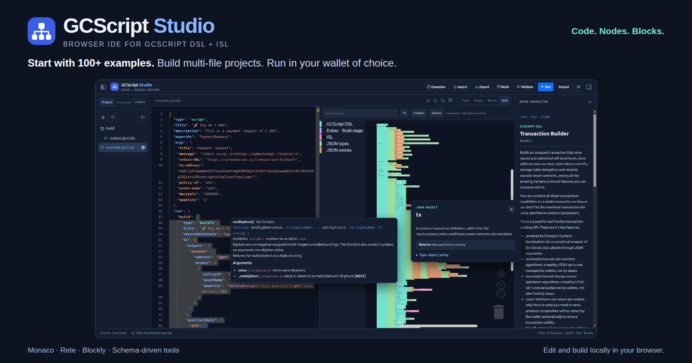

[](https://hits.sh/github.com/GameChangerFinance/gcscript-studio/)

# GCScript Studio

[](https://gamechangerfinance.github.io/gcscript-studio/)

**Write or edit 100+ examples. Explore as code, nodes, or blocks. Build multi-file projects. Run it in GameChanger Wallet or your wallet of choice.**

GCScript Studio is a browser IDE for GCScript DSL and Inline Scripting Language (ISL). It combines a Monaco code editor, a navigable Rete scope graph, a Blockly workspace, and a shared schema-driven inspector. Your project stays in your browser; no Studio backend or wallet connection is required to edit and build.

[🕹️ Open GCScript Studio](https://gamechangerfinance.github.io/gcscript-studio/)

## Learn

- [Docs](https://github.com/GameChangerFinance/gamechanger.wallet/blob/main/docs/README.md)
- [100+ examples](https://github.com/GameChangerFinance/gamechanger.wallet/blob/main/examples/README.md)
- [Language reference](https://wallet.gamechanger.finance/doc/api/v2/)
- [Official GCScript skill](https://github.com/GameChangerFinance/gcscript-dsl-skill)

## Run locally

If you dont want to open the hosted IDE, run it locally with Node.js **24.12 or newer** and pnpm:

```sh
pnpm install --frozen-lockfile --ignore-scripts
pnpm dev
```

Open the address printed by Vite. For a production build, use `pnpm build`, then `pnpm preview`. Deploy the generated **`dist/`** directory.

## Why use Studio?

- **One project, several views.** Edit JSONC in Code, inspect ordered scopes in Nodes, compose values and functions in Blocks, or compare them in Split view.
- **Documentation where you work.** Explore argument types, descriptions, examples, and return contracts in the inspector and tooltips. Follow the same schema definitions used by editor diagnostics and completion.
- **A real virtual filesystem.** Create folders, edit text files, keep binary assets, move or copy entries, and import/export ZIP or TAR.GZ archives. Empty folders survive archive round trips.
- **Project builds.** Resolve local `app://` resources with the official GC builder, then validate the resulting strict JSON. Source files and build output stay separate.
- **Language-aware authoring.** GCScript functions, ISL, build-stage extras, JSON values and user-defined entries have distinct, configurable colors. The block drawer follows their language origin and published ISL groups.
- **Schemas-driven.** Swap the schema files and wallet URL and start coding for other ecosystems and tools beyond **Cardano**.
- **Portable outputs.** Generate strict JSON, wallet URLs, QR images, URL transport data, and HTML, HTML Zero, React, button, or Express snippets.
- **Local control.** Dark/light themes, resizable panels, configurable paths, autosave, project JSON backups, and a version gate for incompatible saved state.

## A typical session

1. Open a file under **Project**, or import a folder/archive. Import asks whether to add a single file to this project or open a new project; opening a new one offers Save ZIP, continue without saving, or cancel. Use the file menu to create, rename, copy, cut, paste, delete, download, or choose the project entrypoint. Explorer shortcuts: Ctrl/Cmd+C, X, V, F2, Delete. Drag into a folder to move; Ctrl/Alt-drag copies. Drop external files, folders, ZIP or TAR.GZ projects onto the explorer. Use **Export → Selected file** for the selected individual file.
2. Choose **Code**, **Nodes**, **Blocks**, or **Split**. Click a value to inspect it. Node links describe JSON containment; source order determines step order.
3. **Build** the configured entrypoint, initially `main.gcscript`. Studio writes `build/output.gcscript` by default. **Validate** checks the active GCScript source after resolving its imports.
4. **Run** builds the active file and opens the wallet or runner of choice directly in a popup. Run writes its return callback into the active source file as an undoable edit. **Options → Run mode** also supports redirecting this window or displaying a QR code.
5. Wallet exports return to `results/result.json` by default. **Merge wallet results** recursively merges named object exports, preserving other exports and replacing incoming arrays/scalars; turn it off to replace the entire result. Use **Output → Import wallet result** for manually copied exports or cross-device QR results.

**Options → Network** controls the wallet `networkTag`. The network router is enabled by default to enforce it. Check **Disable network router** only when you want to use the wallet’s current network. Run opens the final wallet URL without a local intermediate page. If the browser blocks the popup after building, use the prepared **Open wallet** link. The wallet retains control over approvals, signing and submission. See the [official GC transport options](https://github.com/GameChangerFinance/gamechanger#usage).

Text changes in Blocks preserve neighboring JSONC comments. Structural changes that require normalization ask before removing comments. Disconnected blocks, duplicate keys and missing values produce actionable messages instead of silently losing data. Complex ISL stays as exact text when it falls outside the supported graphical subset.

**Examples** opens the official catalog plus two hosted showcases: `project.zip` (a multi-file project) and `example.gcscript` (a single script). Both download dynamically and use the same safe import choices as local files.

**Ctrl/Cmd+Z** undoes and **Ctrl/Cmd+Y** or **Ctrl/Cmd+Shift+Z** redoes across Code, Nodes and Blocks, including function additions, inspector edits/deletion and filesystem changes. Use the search icon beside Undo/Redo to toggle Monaco’s Find and Replace fields, or press **Ctrl/Cmd+F** to find and **Ctrl/Cmd+H** to replace. Monaco also supports formatting, folding, completion and standard editing shortcuts. Buttons provide help on hover or keyboard focus.

Validation runs automatically after an editing pause and periodically during sustained editing. Monaco underlines problems, shows concise GC suggestions and expected examples, and offers **Ctrl+.** quick fixes for exact enum/function corrections. Blocks shows the same GC diagnostics with warning icons, error outlines and a clickable message list that selects the affected value or its nearest container. Use the status-bar problems button or **Validate** for the full report. **Show editor tooltips (Code, Nodes, Blocks)** is enabled by default in Options.

The tooltip icon beside Find/Replace changes that same preference immediately. **Escape** dismisses open code, graphical and button tooltips. Code tooltips can extend across Split panes and sidebars within the IDE viewport.

## Open in IDE links and embedded editors

See the [three-editor HTML example](https://gamechangerfinance.github.io/gcscript-studio/examples/gcscript-studio-three-ides.html) for a standalone documentation page with Code, Nodes and Blocks iframes. Its [HTML source](public/examples/gcscript-studio-three-ides.html) needs no build step or parent-side wallet handler. It allows only the fixed Studio edit endpoint in its iframe CSP, validates frame URLs, and loads no child IDEs if the gallery itself is nested. Supported static-host headers also deny framing the gallery; GitHub Pages uses the client guard because it does not apply custom response headers. The IDE remains embeddable. To host your own copy, update the IDE base, frame links and CSP together; changing the inline bootstrap requires refreshing its CSP hash.

Use **Output → IDE file link** or **IDE project link** to share editable source. File links use the selected file (falling back to the active file) and preserve JSONC comments and formatting. Project links include every VFS file, binary assets, empty directories and the active file. These links open source for editing; they do not build or run it. Check **Embedded mode** in the output dialog to generate a compact editor link.

```text
https://<IDE>/api/2/edit/1-H4sI...?view=code
https://<IDE>/api/2/edit/1-H4sI...?embed=true&view=node
https://<IDE>/api/2/edit/1-H4sI...?embed=true&view=block
```

The route uses the existing **GC URL/message codec**. To create documentation links directly with the official GC library:

```js
const url = await gc.encode.url({
  input: JSON.stringify(script), // raw GCScript object, or exported Studio project JSON
  apiVersion: '2',
  network: 'preprod',
  encoding: 'gzip',
  disableNetworkRouter: true,
  urlPattern: 'https://<IDE>/api/2/edit/{gcscript}',
});
const embedded = new URL(url);
embedded.searchParams.set('embed', 'true');
embedded.searchParams.set('view', 'code'); // code | node | block
```

For subdirectory deployments, include the base directory, for example `https://gamechangerfinance.github.io/gcscript-studio/api/2/edit/{gcscript}`. Do not add a referral address or wallet callback to an editor link. To preserve a filename, source comments or a non-script file, encode this file envelope instead of the raw script:

```js
const payload = {
  format: 'gcscript-studio-file',
  version: 1,
  path: 'examples/payment.gcscript',
  file: { text: sourceJSONC, encoding: 'utf8' }, // base64 for binary files
};
// Pass JSON.stringify(payload) as input to gc.encode.url above.
```

Embed the resulting URL in a documentation page:

```html
<iframe
  title="Editable GCScript example"
  src="https://<IDE>/api/2/edit/1-H4sI...?embed=true&amp;view=code"
  style="width:100%;height:600px;border:0"
  loading="lazy"
></iframe>
```

`embed=true`, `embed=1`, or bare `embed` enables the compact layout. `embed=false` and `embed=0` keep the normal layout. Embedded sessions initially collapse the explorer and inspector, hide secondary navigation, and retain Build, Validate, Run, Output, Options and view controls. Panel toggle buttons can reopen the explorer or inspector. `view=code|node|block` also works without embedded mode; unknown views use the default.

Embedded links replace the **embedded workspace** without prompting. Normal links retain the usual add-file, save-project and replacement decisions. Embedded project/preferences and wallet-return records use a separate localStorage namespace; the normal project stays untouched. Embedded instances share that embedded namespace, while schemas share the usual cache. Browser iframe/storage policies still apply. Keep the iframe tall enough for the chosen editor, and enable popups in any embedding sandbox if users should run scripts in a wallet.

**Run works inside the iframe without turning the parent page into a wallet host.** The IDE saves a correlated callback, opens the wallet popup and captures its returned exports itself. Wallet-facing callbacks contain only `?result={result}`; embedded context travels in the fragment (`#studioRun=embed%3A...`) to avoid HTML-escaped `&embed=true` separators. Capture restores the clean `?embed=true` app URL after saving the result. Browser storage and popup permissions are required; QR results on another device still use manual result import.

Links carry their contents, including any project results. Share only files intended for publication. The configured limits are 2 MiB of encoded payload and 8 MiB of decoded JSON; browsers and hosts may impose much shorter URL limits. Use archives for large projects. The reusable browser adapter is `encodeEditLink` / `decodeEditLink` in `src/adapters/edit-links.ts`; route parsing and validated payload contracts live in `src/core/project/edit-link.ts`.

## Multi-file projects

Keep source readable and let the builder produce wallet-ready JSON. For example:

```text
main.gcscript
data/settings.json
lib/message.gcscript
```

`main.gcscript`:

```json
{
  "type": "script",
  "exportAs": "example",
  "args": { "message": "Hello Cardano" },
  "run": {
    "settings": {
      "type": "$importAsData",
      "as": "object",
      "from": { "settings": "app:///data/settings.json" }
    },
    "message": {
      "type": "$importAsScript",
      "args": "{get('args')}",
      "from": { "helper": "app:///lib/message.gcscript" }
    }
  }
}
```

`lib/message.gcscript`:

```json
{
  "type": "script",
  "args": "{get('args')}",
  "return": { "mode": "last" },
  "run": {
    "message": { "type": "macro", "run": "{get('args.message')}" }
  }
}
```

`data/settings.json` can contain ordinary JSON such as `{"label":"My project"}`.

`$importAsScript` builds a script wrapper with imported `run` children. `$importAsData` builds literal data and supports `object`, `json`, `string`, `hex`, and `base64` conversions. These build-stage directives differ from wallet-runtime `importAsScript` / `importAsData`. Use `app:///path` from the project root and `app://./path` relative to the importing file. Studio enables only `app://` build resources. Read the [official project build documentation](https://github.com/GameChangerFinance/gamechanger#build-multi-file-gcscript-projects).

## Options and project storage

Open **Options** to change schema/wallet URLs, network/router behavior, popup/redirect/QR run mode, optional Cardano referral address, entrypoint/output/result paths, result merging, examples repository/branch/path, themes, graphical settings, tooltips across Code/Nodes/Blocks and output compactness. Enhanced syntax highlighting and autosave stay enabled; debug timing stays disabled. Color policy itself lives in [`src/config.ts`](src/config.ts), including per-function overrides and fallback categories; consumers load it asynchronously through `getConfig()`.

Source authoring uses a virtual schema overlay from [`public/extras.json.full`](public/extras.json.full). The original wallet schema remains separate for final built-output validation. Cached schema URLs remain distinct, and a failed refresh can be retried. Wallet schemas and extras expire after 24 hours, matching GC CLI. The refresh decoration next to the schema URL clears and downloads both. There is no bundled wallet-schema fallback; a failed network load reports an error and remains retryable.

Browser storage is finite. Autosave stays enabled; export project archives or project JSON for backups. Incompatible saved versions pause autosave until you download the saved data and explicitly reset it.

## Learn GCScript

- [GCScript API reference](https://wallet.gamechanger.finance/doc/api/v2/)
- [ISL reference](https://wallet.gamechanger.finance/doc/api/v2/lang.html)
- [GameChanger documentation](https://gamechangerfinance.github.io/gamechanger.wallet/)
- [Official GCScript examples](https://github.com/GameChangerFinance/gamechanger.wallet/blob/main/examples/README.md)
- [GC library and CLI](https://github.com/GameChangerFinance/gamechanger)
- [Official GCScript skill](https://github.com/GameChangerFinance/gcscript-dsl-skill) — recommended when using an AI coding assistant. Ask the assistant to use `gcscript-dsl` and validate against the current official schema.

## Deploy

- **GitHub Pages:** the included workflow tests, builds with `/gcscript-studio/` as its base, and deploys on pushes to `main`. Enable **Settings → Pages → Source → GitHub Actions** in the repository.
- **Apache:** copy `dist/`, including `.htaccess`, into the site directory. Enable `mod_rewrite` and `AllowOverride FileInfo`. For a subdirectory, build with `VITE_BASE_PATH=/your-directory/ pnpm build`.
- **Netlify:** the included configuration builds and publishes `dist/` with SPA fallback routing.
- **Vercel:** the included configuration uses the Vite build and serves the SPA after static assets.

Wallet callbacks use the real `index.html` in the deployment base, including query and fragment data. They do not depend on server-side callback routes. See [deployment details](docs/deployment.md).

## Contribute or reuse modules

Strict TypeScript, purpose-oriented core modules and isolated browser adapters make the project inspectable and reusable. See the [architecture](docs/architecture.md) and [contributing guide](CONTRIBUTING.md) for module boundaries, test commands and verification details.

## Credits

Created by [zxpectre](https://github.com/zxpectre) for [GameChanger Finance](https://github.com/GameChangerFinance).

Thank you **M2Tec** for the early inspiration behind this work: [Inception](https://inception.m2tec.nl/).

Built with React, Monaco, Rete, Blockly, Vite and the official GameChanger library.

[MIT licensed](LICENSE).
